<div align="center">


# Unravel: Free Windows Uninstaller & PC Cleanup Toolkit

**Uninstall programs completely, clean up the leftovers safely, and see what your PC is really doing.**<br>
A free, open-source uninstaller for Windows 10 and 11 with leftover scanning, install tracking, WinGet, a live system monitor and a duplicate file finder in one modern app.

[](https://github.com/Mahdi-hasan-shuvo/unravel-uninstaller/releases/latest)
[](LICENSE)
[](#-system-requirements)
[](https://dotnet.microsoft.com/download/dotnet/8.0)
[](docs/TEST_REPORT.md)
[](https://github.com/Mahdi-hasan-shuvo/unravel-uninstaller/stargazers)

[**Download**](https://github.com/Mahdi-hasan-shuvo/unravel-uninstaller/releases/latest) ·
[Features](#-features) ·
[Screenshots](#-screenshots) ·
[How it works](#-how-it-works) ·
[Build from source](#-build-from-source) ·
[FAQ](#-faq) ·
[Contact](#-contact--hire-me)

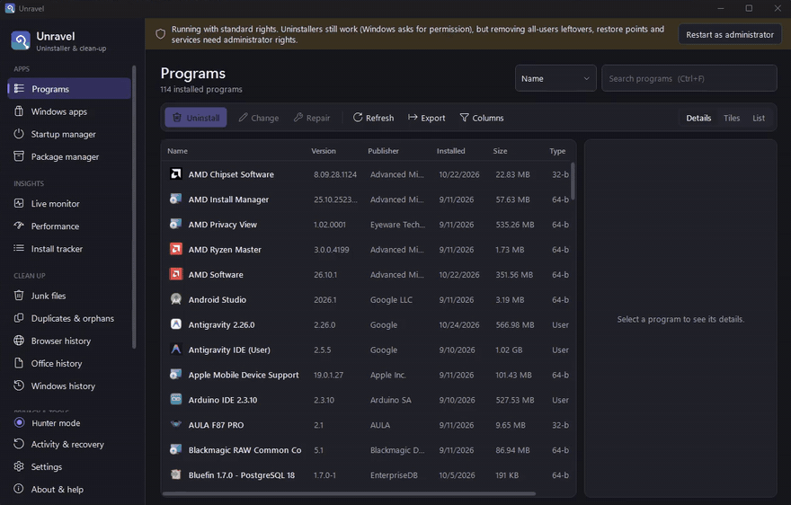

<sub>Real recording: Unravel uninstalls a test program, finds the registry keys and folders its uninstaller left behind, rates each one, and removes them after a preview. <a href="docs/media/unravel-demo.mp4">Full-quality video (MP4)</a></sub>

</div>

---

## 💡 Why Unravel?

When you uninstall a program from Windows Settings, Windows runs the program's own uninstaller and stops there.
Most uninstallers leave registry keys, settings folders, caches, startup entries and scheduled tasks behind.
Over time those leftovers clutter your PC and slow down startup.

Unravel runs the uninstaller **and then finds what it missed**, tells you how sure it is that each item belongs to the program, and lets you remove it with a backup.

| | Windows Settings | Unravel |
|---|:---:|:---:|
| Run the program's uninstaller | ✅ | ✅ |
| Find leftover registry keys, folders and startup entries | ❌ | ✅ |
| Rate every leftover High / Medium / Low and block system-critical items | ❌ | ✅ |
| Back up registry items and quarantine files before removal | ❌ | ✅ |
| Verify afterwards that the program and its leftovers are really gone | ❌ | ✅ |
| Record an installation and remove exactly what it added | ❌ | ✅ |
| Remove Microsoft Store apps *and* their leftovers | Apps only | ✅ |
| Install, update and reinstall apps with WinGet | ❌ | ✅ |

**No account, no ads, no telemetry.** Unravel has no network code of its own; only WinGet operations and the *Search online* buttons go online.

---

## ✨ Features

### 🗑️ Uninstaller

- **Complete uninstall.** Lists every installed program (all users and current user, 64- and 32-bit) with icon, size, version, publisher and install date. Runs the uninstaller, waits for the whole process tree, then scans for leftovers.
- **Three scan modes.** *Safe*, *Moderate* and *Advanced* control how deep the leftover search goes. Results appear as a registry tree and a file list.
- **Post-uninstall verification.** After cleanup, Unravel checks everything again: whether Windows still lists the program, whether the install folder and its running processes are gone, whether every deleted key, value, file and folder is really gone, and a fresh re-scan (at least *Moderate*) for anything still findable. Each item is reported as *Removed*, *Still present*, *After restart* or *Kept*. If anything remains, **Scan again** takes you straight to it.
- **Change, repair and forced MSI uninstall.** Run the installer's modify path, Windows Installer repair or forced removal, or remove a broken entry (with a backup).
- **Windows apps.** List and remove Microsoft Store (MSIX/AppX) apps with the same leftover scan.
- **Hunter mode.** Drag a small target onto any window, desktop shortcut or taskbar button to uninstall that program, stop it from starting with Windows, end it or open its folder.

### 🛡️ Smart safety engine

- Every leftover gets a **High / Medium / Low confidence** badge with an explanation.
- **System-critical items are blocked.** They can't be ticked, even by mistake: Windows folders, core registry areas, boot drivers and core services.
- Items that are in use, Microsoft-signed or shared with another installed program are flagged.
- **Select recommended** ticks only safe items, and **every deletion is previewed first**.
- Registry items are exported to `.reg` files before removal, and files go to a **quarantine you can restore from**.

### 📸 Installation change tracker

- Snapshot files, registry, services, scheduled tasks and startup entries **before and after** you install something.
- See exactly what the installer added or changed, and remove what it added with **one-click undo**.
- The uninstaller uses the recording for an exact cleanup later.

### 📦 WinGet package manager

- Search, install, update one or all, uninstall (followed by a leftover scan) and reinstall packages with Windows' package manager.
- Export your app list and reinstall it on another PC.
- Live output, cancel, and plain-language error messages.

### ⚡ Startup & performance insights

- **Startup impact** of every startup app and service, using Task Manager's High / Medium / Low thresholds, with on/off switches.
- **Boot time**, background processes, a disk usage tree and the largest files.
- **Before & after baselines** that measure what your changes actually did.

### 📈 Live system monitor

- Real-time CPU, memory and disk charts, plus every process and service.
- **Alerts** for sustained high CPU or disk I/O, memory leaks, unsigned programs running from Temp or Downloads, and programs using Windows system file names outside the Windows folder.
- One-click actions on each alert. Critical Windows processes can't be ended.

### 🧹 Cleanup & privacy

- **Duplicate finder.** Matches files by SHA-256 content, never by name. It recognises hard links and always keeps at least one copy.
- **Orphan finder.** Finds folders that no installed program, service, task or shortcut uses any more, and shows the evidence for each one.
- **Junk files.** Finds temporary and leftover files by pattern, with exclusions and a 24-hour safety rule.
- **Browser history.** Cleans Chrome, Edge, Brave, Vivaldi, Opera, Opera GX, Chromium, Firefox and Internet Explorer data.
- **Office and Windows history.** Clears recent-document lists, Run and search history, the clipboard, thumbnail cache, crash dumps and more.
- **Secure delete and free-space wiping.** Overwrites files, or a drive's free space, so deleted data can't be recovered.
- **Startup manager.** Uses the same on/off state as Task Manager. Add, remove and clean up invalid entries.

### 🧰 And more

- One-click access to **18 built-in Windows tools**.
- **Responsive layout.** In narrow windows the sidebar collapses to an icon rail and toolbars wrap, so nothing overlaps down to the 980 × 600 minimum.
- **Activity & recovery.** A daily log of every change Unravel made, and a restore button for quarantined items.
- Light, dark and system themes; a modern Windows 11-style interface.

---

## 📷 Screenshots

| | |
|:---:|:---:|
| 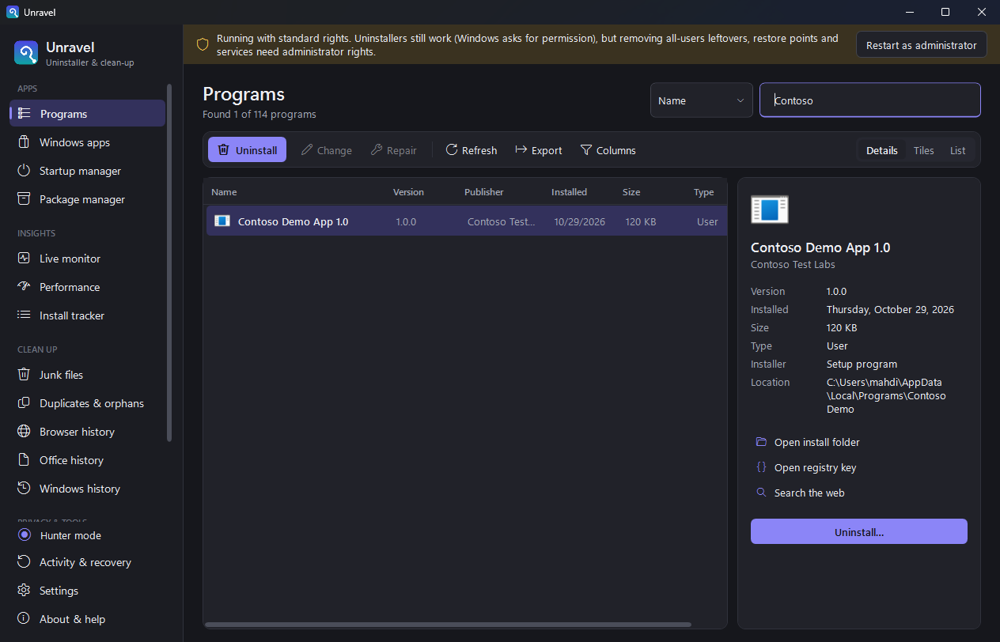<br>**Programs:** every installed app, with details | 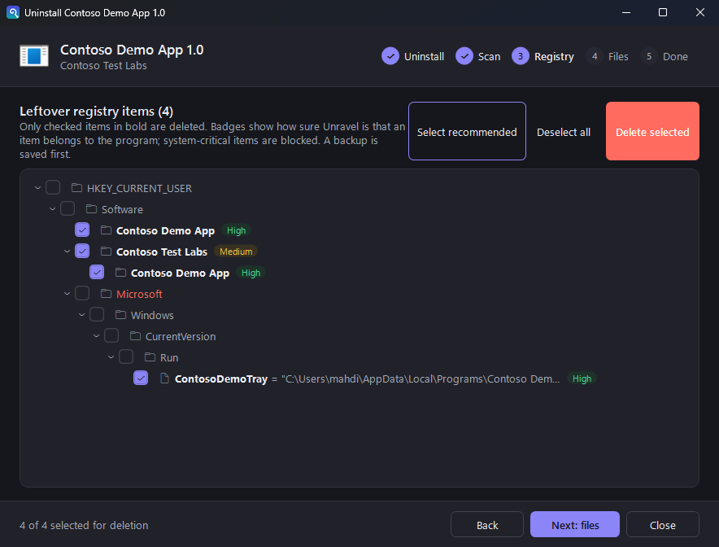<br>**Leftover scan** with confidence badges |
| 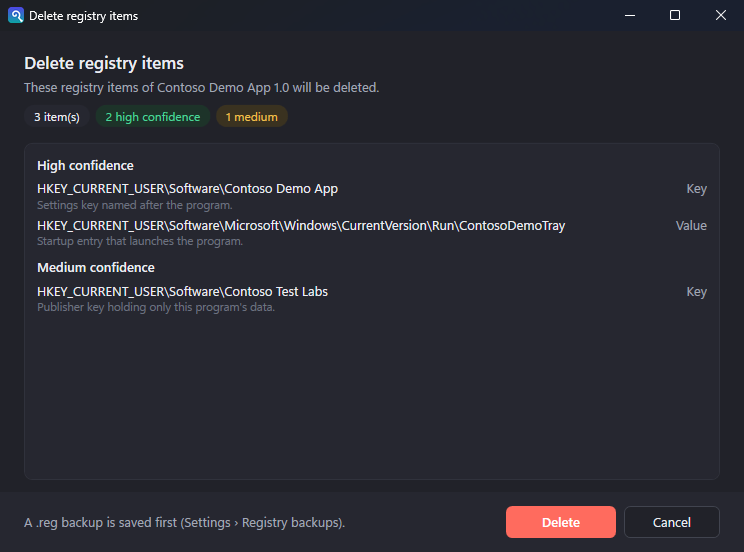<br>**Deletion preview** before anything is removed | 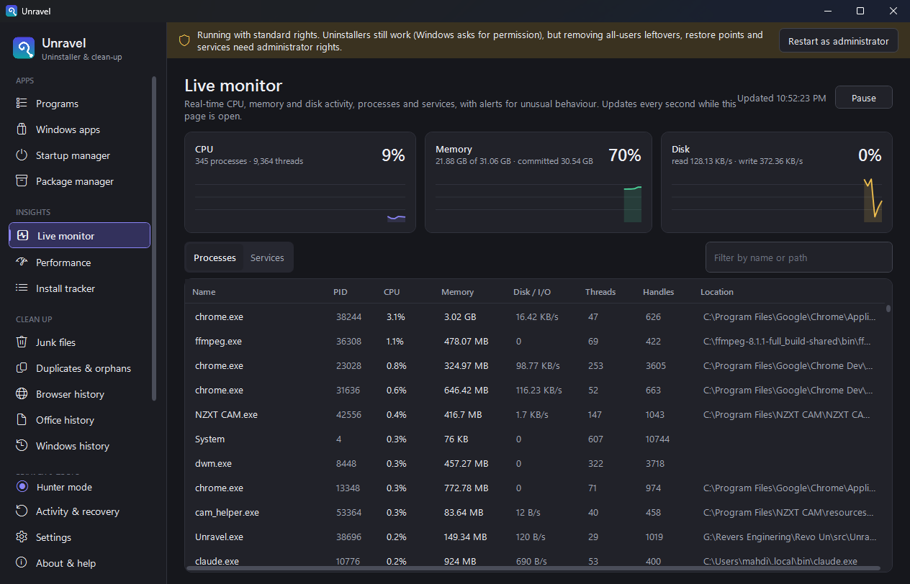<br>**Live monitor** of CPU, memory, disk and processes |
| 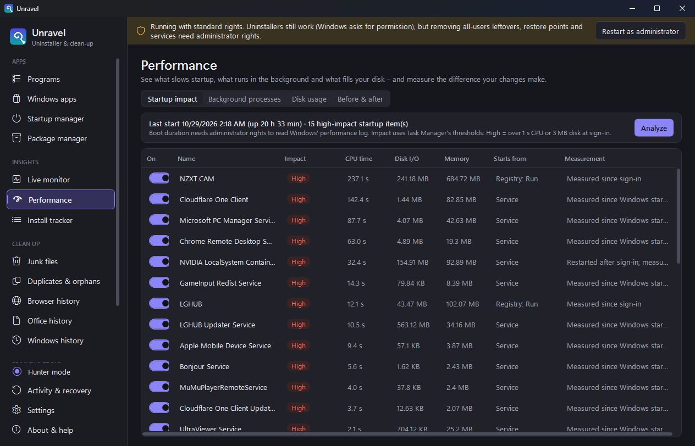<br>**Startup impact** with Task Manager thresholds | 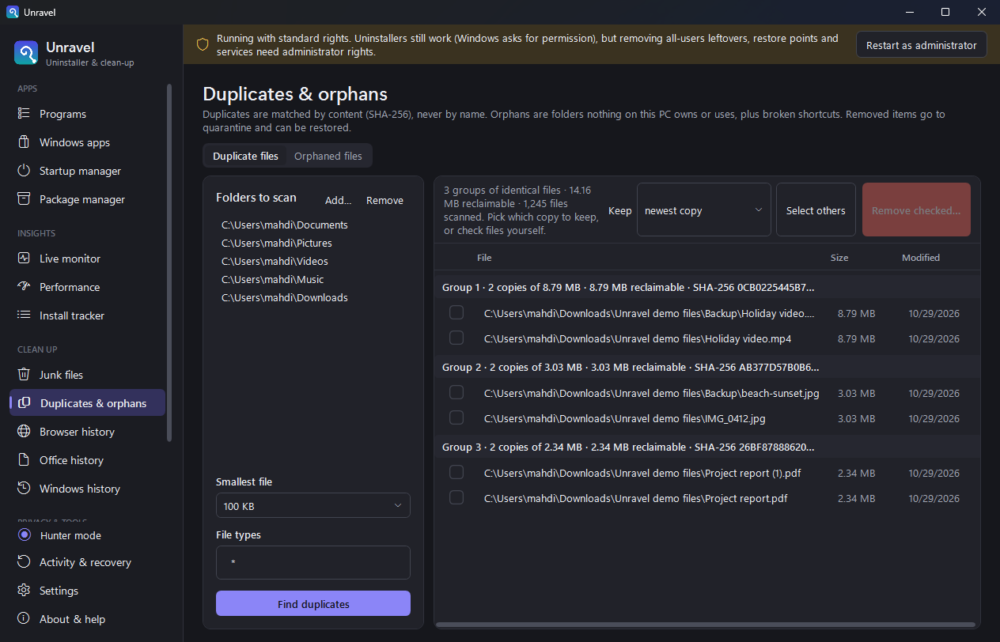<br>**Duplicate finder** matching files by content |
| 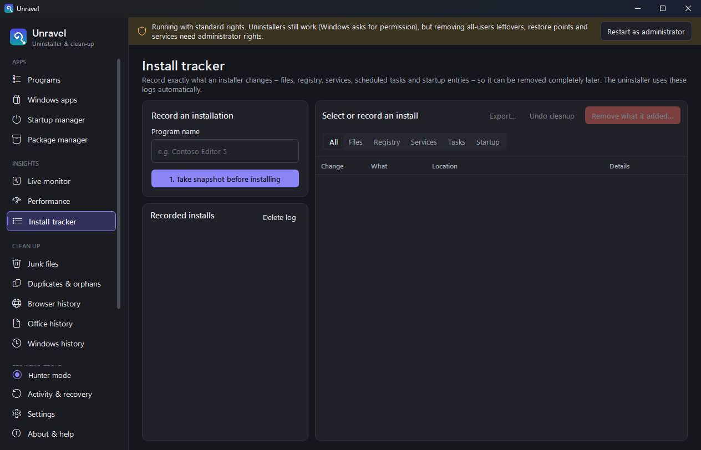<br>**Install tracker** snapshots | 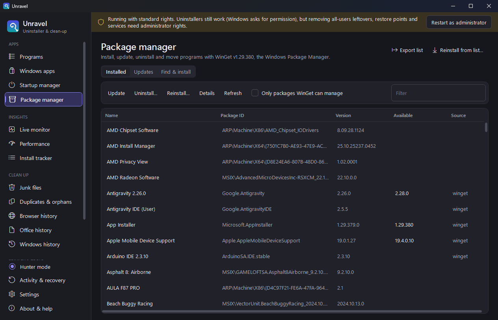<br>**WinGet** package manager |

<details>
<summary><b>More screenshots</b></summary>

| | |
|:---:|:---:|
| 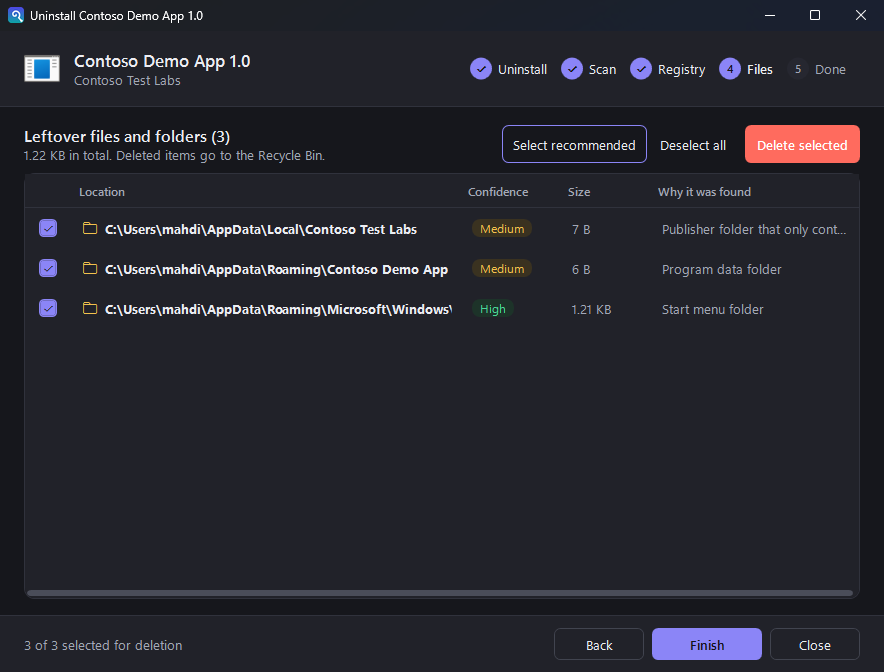<br>Leftover files and folders | 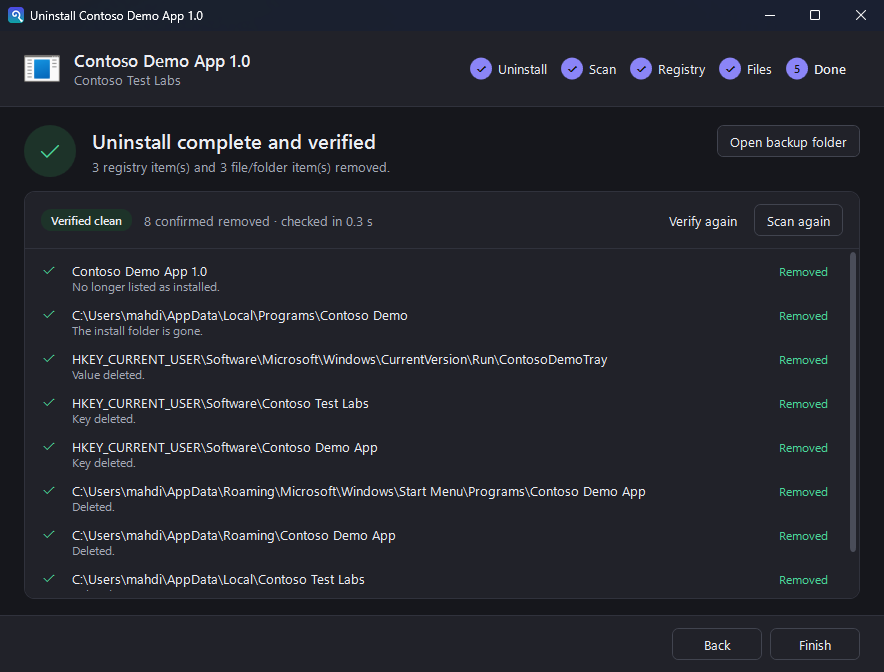<br>Post-uninstall verification |
| 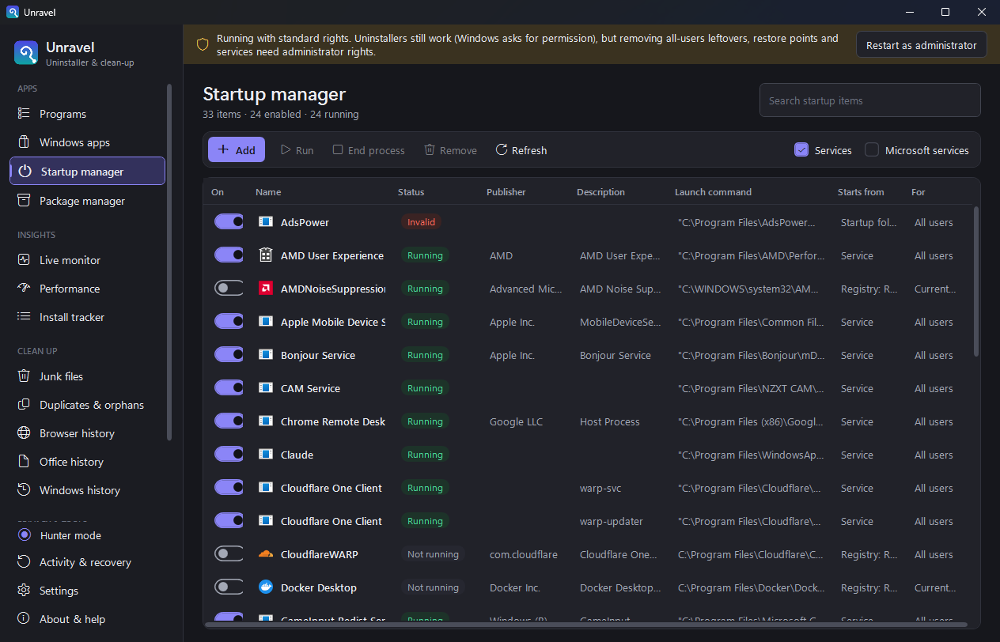<br>Startup manager | 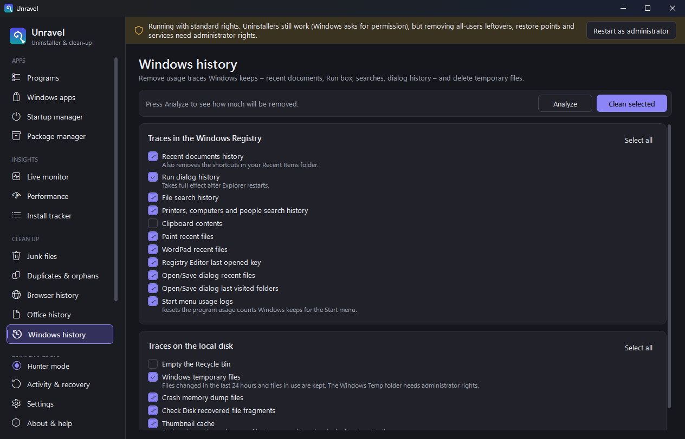<br>Windows history cleaner |

</details>

---

## 🔍 How it works

### The uninstall pipeline

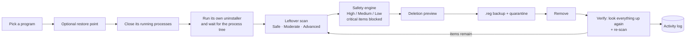

### How leftovers are found and rated

1. **Identify the program.** Unravel uses the uninstall registry entry (name, publisher, install folder, MSI product code), plus the install recording if you tracked the install.
2. **Search known places.** It looks in program and publisher keys under `HKCU` and `HKLM` (including 32-bit views), Program Files, ProgramData, AppData, Start menu shortcuts, Run keys, services and scheduled tasks. Deeper modes search more places.
3. **Rate every match.** The confidence starts from *why* the item was found, then drops for risk signals: in use by a running program, Microsoft-signed, shared with another installed program, or containing other programs.
4. **Protect the system.** Search roots, their parents and system-critical locations are never offered. Blocked items stay blocked even if code tries to delete them.

### Architecture

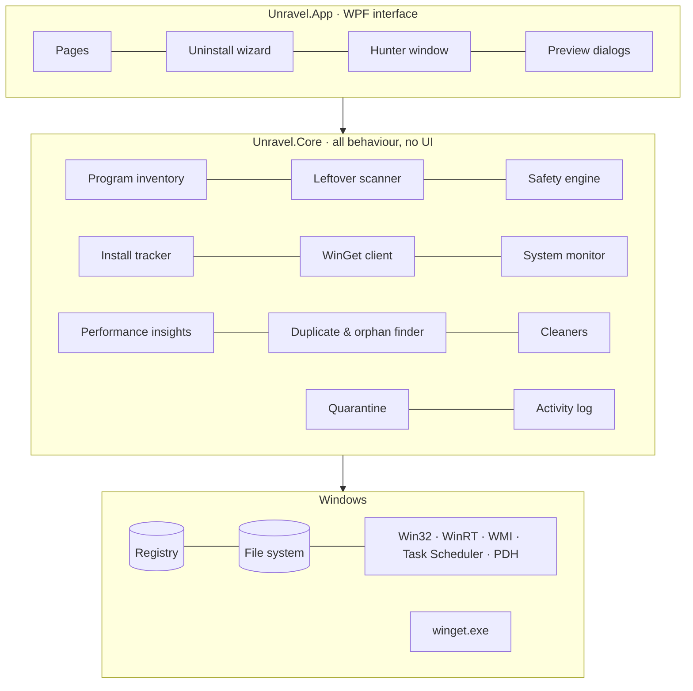

---

## 🚀 Quick start

1. **Download** [`Unravel-1.0.0-win-x64.exe`](https://github.com/Mahdi-hasan-shuvo/unravel-uninstaller/releases/latest/download/Unravel-1.0.0-win-x64.exe) from [Releases](https://github.com/Mahdi-hasan-shuvo/unravel-uninstaller/releases/latest). A zip of the same app is there too.
2. **Double-click** it. No installer and no .NET install needed; it's a single self-contained file.
3. Pick a program, press **Uninstall**, choose a scan mode and review the leftovers.

> [!TIP]
> Unravel works with standard rights. Use **Restart as administrator** (the banner at the top) to remove leftovers that belong to all users, create restore points and manage services.

### 💻 System requirements

| | |
|---|---|
| OS | Windows 10 version 2004 (build 19041) or later, Windows 11 |
| Architecture | x64 |
| Runtime | Included in the release download; building from source needs the .NET 8 SDK |
| Rights | Standard user; administrator for all-users cleanup, restore points and services |

---

## 📖 Usage examples

<details open>
<summary><b>Uninstall a program and clean up its leftovers</b></summary>

1. Open **Programs** and search by name, publisher or any column (`Ctrl+F`).
2. Select the program and press **Uninstall**. Unravel can create a restore point, close the program, and run its uninstaller.
3. Choose **Safe**, **Moderate** (default) or **Advanced** and press **Scan**.
4. Press **Select recommended**. Only High and Medium items without risk flags are ticked.
5. Press **Delete selected**, check the preview, and confirm. Registry items are backed up first and files go to the Recycle Bin or quarantine.
6. The last step shows the **verification**: *Verified clean*, *Clean after restart*, or the items still present with **Scan again** to remove them.

</details>

<details>
<summary><b>Track an installation for a perfect uninstall later</b></summary>

1. Open **Install tracker** and press **1. Take snapshot before installing**, or use **Run an installer and wait…** to do it all in one go.
2. Install the program as usual.
3. Press **2. Finished installing – compare**. You see every added and modified file, key, service, task and startup entry.
4. Keep the recording. When you uninstall the program later, its leftover scan includes everything the install added. Or use **Remove what it added…** right away, and **Undo cleanup** if needed.

</details>

<details>
<summary><b>Move your apps to a new PC with WinGet</b></summary>

1. On the old PC: **Package manager → Export list** saves your installed packages as a WinGet JSON file.
2. On the new PC: **Package manager → Reinstall from list…** installs them, with the latest or the listed versions.

</details>

<details>
<summary><b>Find out what slows down your PC</b></summary>

1. **Performance → Before & after → Capture baseline.**
2. Switch off high-impact items in **Startup impact**, or uninstall what you don't need.
3. Restart, capture a second baseline, select both and press **Compare selected two**. Each measure shows whether it got better or worse.

</details>

<details>
<summary><b>Command line</b></summary>

```powershell
Unravel.exe            # open the main window
Unravel.exe --hunter   # start directly in Hunter mode (used by "start Hunter with Windows")
```

</details>

---

## 🔧 Configuration

Everything is configurable in **Settings**, and stored as readable JSON in `%LOCALAPPDATA%\Unravel\settings.json`:

```json
{
  "Theme": "Dark",
  "Uninstaller": {
    "DefaultScanMode": "Moderate",
    "CreateRestorePoint": true,
    "BackupRegistryBeforeDelete": true,
    "DeleteFilesToRecycleBin": true,
    "CheckAllLeftoversByDefault": false,
    "StopRunningExecutables": true
  },
  "Hunter": { "AlwaysOnTop": true, "TransparencyPercent": 50, "StartWithWindows": false }
}
```

| Setting area | What you can change |
|---|---|
| Appearance | System, light or dark theme; compact rows; details pane; Details, Tiles or List view; visible columns |
| Uninstaller | Default scan mode, restore points, registry backups, Recycle Bin, pre-selection, closing running programs, showing system components and updates |
| Exclusions | Registry and folder exclusion lists with wildcards and include-subkeys |
| Junk files | Drives, patterns, excluded folders, the 24-hour rule |
| Hunter | Always on top, size, transparency, start with Windows |
| Messages | Skip information or confirmation messages |

| Data folder (`%LOCALAPPDATA%\Unravel\…`) | Contents |
|---|---|
| `Backups` | `.reg` exports made before every registry deletion (restorable from Settings) |
| `Quarantine` | Files removed by the tracker, duplicate and orphan finders (restorable from Activity & recovery) |
| `InstallLogs` | Install tracker snapshots and recordings |
| `Logs` | One JSON-lines activity log per day |

---

## 🏗️ Build from source

```powershell
git clone https://github.com/Mahdi-hasan-shuvo/unravel-uninstaller.git
cd unravel-uninstaller
dotnet build Unravel.sln
dotnet run --project src/Unravel.App                  # start the app
dotnet test tests/Unravel.Tests                       # 226 automated tests
dotnet publish src/Unravel.App -c Release -o publish  # framework-dependent build
```

### Project structure

```text
unravel-uninstaller/
├── src/
│   ├── Unravel.Core/          # All behaviour, no UI
│   │   ├── Programs/          #   installed-program inventory, uninstall/modify/repair, export
│   │   ├── Leftovers/         #   leftover scanner, name matching, remover
│   │   ├── Safety/            #   safety engine, signatures, quarantine
│   │   ├── Tracking/          #   snapshots, diffs, install tracker, scheduled tasks
│   │   ├── WinGet/            #   WinGet client, output parser, error mapping
│   │   ├── Monitoring/        #   live sampling, alerts, services, process guard
│   │   ├── Performance/       #   startup impact, boot info, disk usage, baselines
│   │   ├── Files/             #   duplicate and orphan finders
│   │   ├── Cleaners/          #   browser, Office and Windows history
│   │   ├── Junk/ Secure/      #   junk scanner, secure delete, free-space wiper
│   │   ├── Autorun/ Apps/     #   startup manager, Microsoft Store apps
│   │   ├── Hunter/ Tools/     #   Hunter target resolution, Windows tools
│   │   └── Logging/ Settings/ SystemOps/ Native/ Util/
│   └── Unravel.App/           # WPF interface: pages, uninstall wizard, dialogs, Hunter, themes
├── tests/
│   ├── Unravel.Tests/         # xUnit tests in a sandboxed registry key and temp folders
│   └── e2e/                   # UI Automation scripts and a harmless demo program with leftovers
└── docs/                      # feature notes, test report, research notes, media
```

### Tech stack

| Layer | Technology |
|---|---|
| Language & runtime | C# on .NET 8 |
| UI | WPF with custom light and dark themes; Per-Monitor V2 DPI |
| Windows integration | Registry, Win32 P/Invoke (`NtQuerySystemInformation`, PDH, `WinVerifyTrust`, `SHFileOperation`), WinRT `PackageManager`, WMI restore points, Task Scheduler COM, UI Automation |
| Data | System.Text.Json settings, Microsoft.Data.Sqlite for browser databases, compressed binary snapshots |
| Package management | `winget.exe`, with a language-independent output parser |
| Testing | xUnit (226 tests) and end-to-end UI Automation scripts |

---

## ✅ Quality & testing

- **226 automated tests, 0 failing.** They cover the inventory, leftover scanner, safety engine, tracker, WinGet parser, monitor, performance, cleaners, secure delete and more. Every registry test runs in a sandbox key and every file test in a temp folder.
- **End-to-end UI tests** drive the real app through Windows UI Automation. They cover full uninstalls in all three modes, the install tracker with undo, Hunter mode, WinGet install and uninstall, and live-monitor alerts.
- **Checked against Windows.** The program list matches Windows' own *Programs and Features* (0 missing), and startup states match Task Manager.
- **Zero compiler warnings** in Release builds.
- **Fast and responsive.** Measured on a real PC with 113 programs: the program list loads in 35 ms; leftover scans average 0.3 s (Safe), 0.5 s (Moderate) and 1.5 s (Advanced); an install-tracker snapshot of 900,000 files and 470,000 registry keys takes about 11 s, walked in parallel. Deletions, scans and verification run in the background, and a UI-thread probe measured no stall above 250 ms on any page.

See the full [test report](docs/TEST_REPORT.md), including what could not be tested and why.

---

## 🔒 Security & safety

- Only **checked** items are deleted, and only after a **preview**.
- **System-critical** paths, keys, services and processes are blocked at the engine level, not only in the UI.
- **Every registry deletion is preceded by a `.reg` backup.** If the backup fails, nothing is deleted.
- Files go to the **Recycle Bin or a quarantine** with a restore button. Install-tracker cleanups have a full **undo**.
- Unravel runs **as a standard user** by default and asks before restarting as administrator.
- **Every change is logged** in `%LOCALAPPDATA%\Unravel\Logs`.

Found a safety or security issue? Please report it privately; see [SECURITY.md](SECURITY.md).

---

## 🧭 Roadmap

- [x] Complete uninstaller with Safe / Moderate / Advanced leftover scans
- [x] Smart safety engine, deletion preview, quarantine and registry backups
- [x] Installation change tracker with undo
- [x] WinGet integration, performance insights, live monitor, duplicate and orphan finder
- [x] Post-uninstall verification, 3× faster install snapshots, responsive layout
- [ ] Code-signed releases
- [ ] Publish to WinGet, Scoop and Chocolatey
- [ ] Translations (the interface is English-only today)
- [ ] Built-in update check
- [ ] Continuous integration with GitHub Actions
- [ ] Tracker snapshots of the Windows folder (drivers that installers copy into `System32`)

Have an idea? [Open a feature request](https://github.com/Mahdi-hasan-shuvo/unravel-uninstaller/issues/new?template=feature_request.yml).

---

## ❓ FAQ

<details>
<summary><b>Is Unravel really free?</b></summary>

Yes. Unravel is open source under the [MIT license](LICENSE): free for personal and commercial use, with no ads, accounts or paid tiers.
</details>

<details>
<summary><b>Is it safe to delete leftovers?</b></summary>

Unravel is built to be careful. Nothing is deleted unless you tick it, and you see a preview first. System-critical items can't be ticked at all. Each item shows how confident Unravel is that it belongs to the program. Registry items are backed up and files can be restored. If you're unsure, use **Select recommended**, which only ticks High and Medium items without risk flags.
</details>

<details>
<summary><b>Do I need administrator rights?</b></summary>

No. Uninstalling works with standard rights; Windows asks for permission when an uninstaller needs it. Administrator rights are only needed to remove leftovers that belong to all users (under `HKEY_LOCAL_MACHINE` and Program Files), create restore points, change services and read the boot duration. Unravel shows a **Restart as administrator** button when that matters.
</details>

<details>
<summary><b>Can I undo a cleanup?</b></summary>

Yes. Registry backups can be restored from **Settings › Registry backups**. Quarantined files can be restored from **Activity & recovery**. Install-tracker cleanups have **Undo cleanup**. Files deleted to the Recycle Bin can be restored from there.
</details>

<details>
<summary><b>Does Unravel collect data or need internet?</b></summary>

No. Unravel has no telemetry and no network code of its own. Only WinGet operations (which run Microsoft's `winget.exe`) and the *Search online* buttons, which open your browser, use the internet.
</details>

<details>
<summary><b>Is Unravel a Revo Uninstaller alternative?</b></summary>

Yes. Unravel covers the features of Revo Uninstaller Free 2.6.8, and adds the safety engine, install tracker, WinGet, performance insights, live monitor and duplicate/orphan finder. It is an independent clean-room project, built from public documentation and black-box observation only. It contains no code, text, icons or assets from Revo Uninstaller and is not affiliated with VS Revo Group. The item-by-item [feature parity matrix](docs/FEATURE_PARITY.md) shows the status of each feature.
</details>

<details>
<summary><b>Why does Windows SmartScreen warn about the download?</b></summary>

The release isn't code-signed yet, so SmartScreen may show "Windows protected your PC" for a new download. Choose **More info → Run anyway**, or build it yourself from source. Code signing is on the roadmap.
</details>

<details>
<summary><b>Does it work on Windows 7 or 8?</b></summary>

No. Unravel needs Windows 10 version 2004 or later, or Windows 11.
</details>

---

## 📬 Contact & hire me

Questions, feedback, or a project in mind? Get in touch:

| | |
|---|---|
| 📧 **Email** | [shuvobbhh@gmail.com](mailto:shuvobbhh@gmail.com) |
| 💬 **WhatsApp** | [wa.me/8801616397082](https://wa.me/8801616397082) |
| 💼 **Work** | Open to paid projects and collaboration: Windows desktop apps, system tools and automation. |

For bugs and feature requests, please use [GitHub Issues](https://github.com/Mahdi-hasan-shuvo/unravel-uninstaller/issues) so others can follow along.

---

## 🤝 Contributing

Contributions are welcome: bug reports, fixes, tests and features. Read [CONTRIBUTING.md](CONTRIBUTING.md) to get started. Good first steps:

- Try Unravel on your PC and [report anything odd](https://github.com/Mahdi-hasan-shuvo/unravel-uninstaller/issues/new?template=bug_report.yml).
- Pick an item from the [roadmap](#-roadmap).
- Help translate the interface.

## 📚 Documentation

- [New features](docs/NEW_FEATURES.md): the safety engine, tracker, WinGet, performance, duplicates and monitor in depth.
- [Feature parity matrix](docs/FEATURE_PARITY.md): every feature with its evidence.
- [Test report](docs/TEST_REPORT.md): automated and end-to-end results, and known limits.
- [Research notes](docs/RESEARCH.md): how the clean-room analysis was done.

## 📄 License

[MIT](LICENSE) © 2026 Mahdi Hasan Shuvo.

*Revo Uninstaller is a trademark of VS Revo Group Ltd. Windows is a trademark of Microsoft Corporation. They are mentioned only to describe compatibility and purpose.*

---

<div align="center">

### ⭐ If Unravel cleaned up your PC, star the repo so others can find it.

[**Download Unravel**](https://github.com/Mahdi-hasan-shuvo/unravel-uninstaller/releases/latest) · [Contact](mailto:shuvobbhh@gmail.com) · [Report a bug](https://github.com/Mahdi-hasan-shuvo/unravel-uninstaller/issues) · [Request a feature](https://github.com/Mahdi-hasan-shuvo/unravel-uninstaller/issues/new?template=feature_request.yml)

</div>
